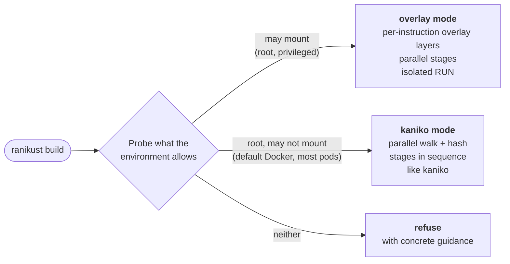

<div align="center">

# ranikust

**Build container images from Dockerfiles. Anywhere. One static binary.**

[](#status)
[](https://github.com/tran4774/ranikust/releases)
[](#license)
[](https://www.rust-lang.org)
[](#status)

[Why](#why-ranikust) ·
[How it works](#how-it-works) ·
[Install](#install) ·
[Compared to](#how-it-compares) ·
[Early numbers](#early-numbers) ·
[Roadmap](#roadmap) ·
[Docs](#documentation)

</div>

ranikust is a daemonless image builder written in Rust, designed as a drop-in
successor to [kaniko](https://github.com/osscontainertools/kaniko). It reads a
Dockerfile, runs it, and pushes an OCI image, from a single static Linux binary
that works inside a locked-down CI container as well as directly on a host or
VM.

> [!WARNING]
> **ranikust is pre-alpha.** It builds and pushes images as root, in overlay
> mode or in kaniko mode, and has been measured against kaniko on test
> workloads in a VM, not yet on real projects. Releases are pre-releases: try
> it, report what breaks, and do not rely on it in production yet.

## Why ranikust

Every image builder makes you pick a side. BuildKit and buildah are fast but
need user namespaces or mount rights that locked-down CI does not grant.
kaniko runs in any default pod, but only inside its own container, one stage at
a time, walking the whole filesystem after every instruction.

ranikust probes what the environment allows and uses the fastest strategy
available:

- **One binary, zero dependencies.** A static musl executable: no daemon, no
  `runc`, no container runtime, no config files.
- **Fast where it may be.** With mount rights it snapshots with overlayfs,
  capturing each instruction's diff without scanning the filesystem, and builds
  independent stages in parallel.
- **Works where others refuse.** In a default Docker container or Kubernetes
  pod it falls back to a kaniko-style snapshot with a parallel walk.
- **Honest about safety.** It never silently degrades isolation: it picks a
  mode, logs why, and stops with clear guidance where no mode is safe.
- **Familiar.** It accepts kaniko's common flags, so pipelines can switch with
  few changes.

## How it works



The probe performs each step for real (enter a mount namespace, mount an
overlay, mount `/proc`, `pivot_root`) instead of guessing from kernel versions,
because many environments allow the first step and block a later one
([ADR-0002](docs/adr/0002-two-snapshot-modes.md),
[ADR-0004](docs/adr/0004-support-every-privilege-level.md)). Which mode each
environment gets is in the book:
[Choosing where to run it](docs/book/src/where-to-run.md). Rootless overlay
mode, for a regular user, is Phase 3; today every user but root is refused.

## Install

Pre-alpha releases are on the
[releases page](https://github.com/tran4774/ranikust/releases): one static
binary for x86_64 Linux (5.8 or later), with its SHA-256 checksum and a build
provenance attestation. Check both before you run it: the
[installation guide](docs/book/src/install.md) has the commands, and the
container examples.

Then, as root on a host (see the [book](docs/book/src/usage.md) for the flags):

```sh
ranikust --context=. --destination=registry.example.com/team/app:1.0
```

## How it compares

Pre-alpha: where ranikust has a check mark, it works on the test workloads, not
yet in wide use. Sources and caveats:
[privilege matrix](docs/research/experiments/03-privilege-matrix.md).

| | ranikust | kaniko | BuildKit | buildah |
|---|:---:|:---:|:---:|:---:|
| Single static binary, no runtime or config | ✅ | ❌ ships as an image | ❌ several binaries | ❌ needs `runc`/`crun` + config |
| Runs directly on a host or VM | ✅ | ❌ container only | ✅ | ✅ |
| Runs in a default, unprivileged container or pod | ✅ | ✅ | ⚠️ needs relaxed seccomp/AppArmor | ❌ |
| Overlay snapshots, no full filesystem scan | ✅ when allowed | ❌ | ✅ | ✅ |
| Parallel stages | ✅ except kaniko mode on a container's `/` | ❌ | ✅ | ✅ |
| No daemon | ✅ | ✅ | ⚠️ one temporary daemon per build | ✅ |
| Accepts kaniko's flags | ✅ | ✅ | ❌ | ❌ |

## Early numbers

The design was measured before a line of ranikust was written, with prototypes
of both snapshot modes on the same machine, the same Dockerfiles and the same
registry (median of 5 rounds, 32 CPUs). These are prototype measurements, not
benchmarks of a released tool; the method and caveats are in experiments
[07](docs/research/experiments/07-kaniko-vs-overlay.md) and
[08](docs/research/experiments/08-parallel-stages-lazy-export.md).

| Workload | Time |
|---|---:|
| **W1**, Next.js app, full build with pull and push: kaniko 1.28.6 | 35.6 s |
| W1: kaniko with every optimization we could add | 15.6 s |
| W1: ranikust kaniko-mode prototype | 11.3 s |
| W1: **ranikust overlay-mode prototype** | **~10 s** |
| **W3**, three independent stages: kaniko, optimized | 19.9 s |
| W3: BuildKit, parallel | 9.4 s |
| W3: **ranikust overlay-mode prototype, parallel stages** | **6.0 s** |

## Status

Pre-alpha. Phase 1 (overlay mode as root) and Phase 2 (kaniko mode) are done,
and v0.0.1 is a pre-release. Releases are built for `x86_64-unknown-linux-musl`;
`aarch64` is kept buildable and tested in CI
([ADR-0009](docs/adr/0009-x86-64-first-aarch64-ready.md)). ranikust requires
Linux 5.8 or later
([ADR-0028](docs/adr/0028-minimum-kernel-linux-5-8.md)).

The design came out of a survey with 16 experiments (overlayfs semantics at
every privilege level, `RUN` sandboxing, rootful Docker under cgroup v1 and v2,
parallel stages without mount rights, real-world builds) and every decision is
an [architecture decision record](docs/adr/). What does not work yet is on the
book's [status page](docs/book/src/status.md).

## Roadmap

Work is tracked on the [Project](https://github.com/users/tran4774/projects/1);
each phase is a milestone.

- [x] **Phase 0, survey:** feasibility, design and 16 experiments
- [x] **Phase 1, MVP:** overlay mode as root, parallel stages, lazy layer
      export, push to registries, `RUN --mount=type=cache|secret`
- [x] **Phase 2, kaniko mode:** parallel walk and hash; builds on a container's
      `/` (stages one at a time) or in a directory per stage (stages in
      parallel). On the three test workloads in a VM the images match kaniko's
      apart from known differences, and every build is faster than kaniko's.
      `--parallel-stages` and `--single-snapshot` are refused
      ([ADR-0060](docs/adr/0060-copy-leaves-special-files-out-where-run-has-no-nodev.md),
      [ADR-0065](docs/adr/0065-single-snapshot-refused-for-good.md))
- [ ] **Phase 3, rootless and probing**
      ([#41](https://github.com/tran4774/ranikust/issues/41)): user-namespace
      overlay, a test matrix across privilege levels, `--seccomp` and
      `--userns`; automatic mode selection and refusing with guidance are
      already built
- [ ] **Phase 4, cache:** versioned cache keys, registry-backed layer cache
- [ ] **Phase 5, feature parity:** `ADD` from URLs and git, bind mounts,
      `ONBUILD`, `COPY --link`, registry mirrors, credential helpers
- [ ] **Phase 6, hardening and 1.0:** the full kaniko integration corpus in
      every mode, fuzzing, host-safety tests, signed static releases

1.0 needs all three ways of building: overlay as root, rootless overlay, and
kaniko mode. Not planned: `bake`, a cache warmer, cloud-storage build contexts,
and multi-platform builds through emulation
([ADR-0008](docs/adr/0008-out-of-scope-bake-warmer-cloud-contexts.md),
[ADR-0009](docs/adr/0009-x86-64-first-aarch64-ready.md)).

## Documentation

| | |
|---|---|
| **User guide** | [`docs/book/`](docs/book/src/introduction.md): install, command line, how it builds, where to run it, status |
| **Decisions** | [`docs/adr/`](docs/adr/): what was decided and why, with the evidence |
| **Research** | [`docs/research/`](docs/research/): the survey and every experiment behind the design |
| **Design** | [`docs/design/`](docs/design/) and [`ARCHITECTURE.md`](ARCHITECTURE.md) |
| **Security** | [`SECURITY.md`](SECURITY.md): how to report a vulnerability, and what is in scope |
| **Contributing** | [`CONTRIBUTING.md`](CONTRIBUTING.md), [`docs/testing.md`](docs/testing.md), the [open questions](https://github.com/tran4774/ranikust/issues?q=is%3Aissue+is%3Aopen+label%3Aquestion) waiting for an answer |
| **AI coding agents** | [`CLAUDE.md`](CLAUDE.md) and [`docs/agents/`](docs/agents/README.md): a compact, task-oriented map of the code |

## Contributing

ranikust is at the very beginning, which is the best time to shape it. Issues
and discussions about the design are welcome; the
[open questions](https://github.com/tran4774/ranikust/issues?q=is%3Aissue+is%3Aopen+label%3Aquestion)
and [good first issues](https://github.com/tran4774/ranikust/issues?q=is%3Aissue+is%3Aopen+label%3A%22good+first+issue%22)
are a good place to start. Read [`CONTRIBUTING.md`](CONTRIBUTING.md) for the
development loop and the [code of conduct](CODE_OF_CONDUCT.md) first.

```sh
git clone https://github.com/tran4774/ranikust && cd ranikust
just check   # format, lint, test (needs `just`; rustup installs the pinned toolchain)
```

## Acknowledgements

ranikust stands on the work of
[kaniko](https://github.com/osscontainertools/kaniko) and its maintainers,
[BuildKit](https://github.com/moby/buildkit),
[buildah](https://github.com/containers/buildah) and the
[OCI](https://opencontainers.org) specifications.

## License

Licensed under either of

- Apache License, Version 2.0 ([LICENSE-APACHE](LICENSE-APACHE) or
  <https://www.apache.org/licenses/LICENSE-2.0>)
- MIT license ([LICENSE-MIT](LICENSE-MIT) or
  <https://opensource.org/licenses/MIT>)

at your option.

Unless you explicitly state otherwise, any contribution intentionally submitted
for inclusion in the work by you, as defined in the Apache-2.0 license, shall be
dual licensed as above, without any additional terms or conditions.
