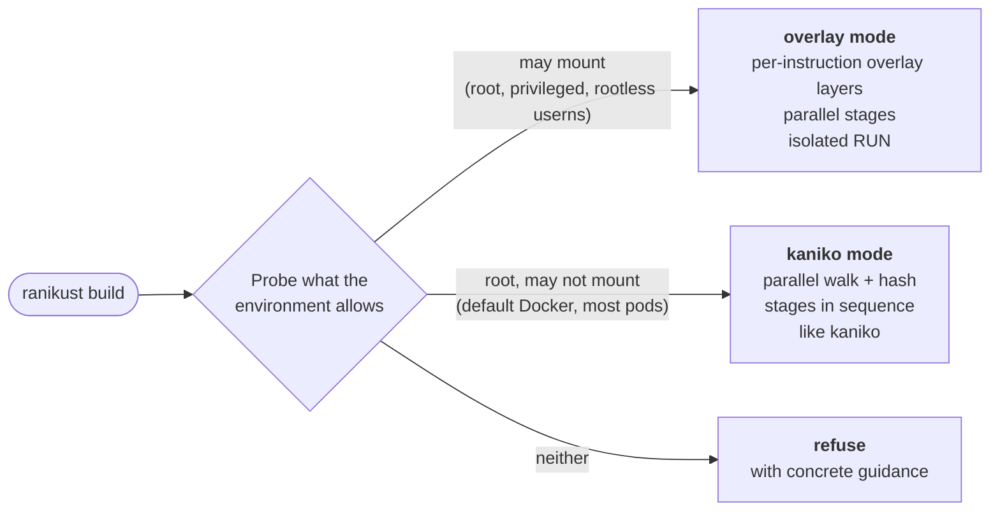

# ranikust

**Build container images from Dockerfiles. Anywhere. One static binary.**

[Why](#why-ranikust) ·
[How it works](#how-it-works) ·
[Compared to](#how-it-compares) ·
[Early numbers](#early-numbers) ·
[Roadmap](#roadmap) ·
[Docs](#documentation)

ranikust is a daemonless image builder written in Rust, designed as a
drop-in successor to [kaniko](https://github.com/osscontainertools/kaniko).
It reads a Dockerfile, runs it, and pushes an OCI image, from a single
static Linux binary that works inside a locked-down CI container as well as
directly on a host or VM.

> [!WARNING]
> **ranikust is pre-alpha and does not build images yet.** The design is
> complete and backed by 16 experiments; the implementation has just started.
> Star or watch the repository to follow along.

## Why ranikust

Every image builder makes you pick a side. BuildKit and buildah are fast but
need user namespaces or mount rights that locked-down CI does not grant.
kaniko runs in any default pod, but only inside its own container, one stage
at a time, walking the whole filesystem after every instruction.

ranikust refuses to pick a side. It probes what the environment allows and
uses the fastest strategy available:

- **One binary, zero dependencies.** A static musl executable: no daemon, no
  `runc`, no container runtime, no config files. Copy it anywhere and run it.
- **Fast where it may be.** With mount rights it snapshots with overlayfs,
  capturing each instruction's diff without scanning the filesystem, and
  builds independent stages in parallel.
- **Works where others refuse.** In a default Docker container or Kubernetes
  pod it falls back to a kaniko-style snapshot with a parallel, cached walk.
- **Honest about safety.** It never silently degrades isolation: it picks a
  mode, logs why, and stops with clear guidance where no mode is safe.
- **Familiar.** Accepts kaniko's common flags, so pipelines can switch with
  few changes.

## How it works

The probe performs each step for real (create a namespace, write the uid
map, mount an overlay, mount `/proc`, `pivot_root`) instead of guessing from
kernel versions, because many environments allow the first step and block a
later one.

| Where you run it | Mode |
|---|---|
| Host or VM as root, privileged container | overlay |
| Rootless podman, regular user on Debian, Fedora or RHEL | overlay (rootless) |
| Default Docker container, ordinary Kubernetes pod, GKE Autopilot | kaniko |
| Regular user on Ubuntu 24.04+ without an AppArmor profile, PSS-restricted pod | refuses, explains what to change |

## How it compares

Target design; nothing here is released yet.

| | ranikust | kaniko | BuildKit | buildah |
|---|:---:|:---:|:---:|:---:|
| Single static binary, no runtime or config | ✅ | ❌ ships as an image | ❌ several binaries | ❌ needs `runc`/`crun` + config |
| Runs directly on a host or VM | ✅ | ❌ container only | ✅ | ✅ |
| Runs in a default, unprivileged container or pod | ✅ | ✅ | ⚠️ needs relaxed seccomp/AppArmor | ❌ |
| Overlay snapshots, no full filesystem scan | ✅ when allowed | ❌ | ✅ | ✅ |
| Parallel stages | ✅ | ❌ | ✅ | ✅ |
| No daemon | ✅ | ✅ | ⚠️ one temporary daemon per build | ✅ |
| Accepts kaniko's flags | ✅ | ✅ | ❌ | ❌ |

Sources and caveats are in the survey's privilege matrix, which will be
published with the documentation.

## Early numbers

The design was measured before a line of ranikust was written, using
prototypes of both snapshot modes on the same machine, the same Dockerfiles
and the same registry (median of 5 rounds, 32 CPUs).

| Next.js app, full build with pull and push (W1) | Time |
|---|---:|
| kaniko 1.28.6 | 35.6 s |
| kaniko with every optimization we could add | 15.6 s |
| ranikust kaniko-mode prototype | 11.3 s |
| **ranikust overlay-mode prototype** | **~10 s** |

| Three independent stages (W3) | Time |
|---|---:|
| kaniko, optimized | 19.9 s |
| BuildKit, parallel | 9.4 s |
| **ranikust overlay-mode prototype, parallel stages** | **6.0 s** |

These are prototype measurements, not benchmarks of a released tool. The
full method, environment and caveats are written up in the survey's
experiment reports, which will be published with the documentation.

## Status

The survey phase is complete. It answered whether this is feasible and how,
with 16 experiments covering overlayfs semantics at every privilege level,
`RUN` sandboxing, real rootful Docker under cgroup v1 and v2, parallel stages
without mount rights, and real-world builds (Next.js, Maven, Gradle). Every
decision that came out of it is recorded as an architecture decision record.

Releases will target `x86_64-unknown-linux-musl` first, with `aarch64` kept
buildable from day one.

## Roadmap

- [x] **Phase 0, survey:** feasibility, design and 16 experiments
- [ ] **Phase 1, MVP:** overlay mode as root, parallel stages, lazy layer
      export, push to registries, `RUN --mount=type=cache|secret`
- [ ] **Phase 2, kaniko mode:** parallel walk and hash, safe workdir handling
- [ ] **Phase 3, rootless and probing:** user-namespace overlay, automatic
      mode selection, a test matrix across privilege levels
- [ ] **Phase 4, cache:** versioned cache keys, registry-backed layer cache
- [ ] **Phase 5, feature parity:** `ADD` from URLs and git, bind mounts,
      `ONBUILD`, `COPY --link`, registry mirrors, credential helpers
- [ ] **Phase 6, hardening and 1.0:** the full kaniko integration corpus in
      every mode, fuzzing, host-safety tests, signed static releases

Not planned: `bake`, a cache warmer, cloud-storage build contexts, and
multi-platform builds through emulation.

## Documentation

The documentation is being prepared for publication and will land here
soon:

- **Decisions:** architecture decision records, what was decided and why,
  each with its evidence.
- **Research:** the survey and all 16 experiments behind the design.
- **Design:** the architecture overview and per-component design documents.
- **Security policy:** how to report a vulnerability and what is in scope.
  Until it is published, please report security issues privately to the
  maintainer through GitHub rather than in a public issue.

## Contributing

ranikust is at the very beginning, which is the best time to shape it.
Issues and discussions about the design are welcome now; code contributions
open with Phase 1. Please read the [code of conduct](CODE_OF_CONDUCT.md)
first.

## Acknowledgements

ranikust stands on the work of [kaniko](https://github.com/osscontainertools/kaniko)
and its maintainers, [BuildKit](https://github.com/moby/buildkit),
[buildah](https://github.com/containers/buildah) and the
[OCI](https://opencontainers.org) specifications.

## License

Licensed under either of

- Apache License, Version 2.0 ([LICENSE-APACHE](LICENSE-APACHE) or
  <https://www.apache.org/licenses/LICENSE-2.0>)
- MIT license ([LICENSE-MIT](LICENSE-MIT) or
  <https://opensource.org/licenses/MIT>)

at your option.

Unless you explicitly state otherwise, any contribution intentionally submitted
for inclusion in the work by you, as defined in the Apache-2.0 license, shall be
dual licensed as above, without any additional terms or conditions.
