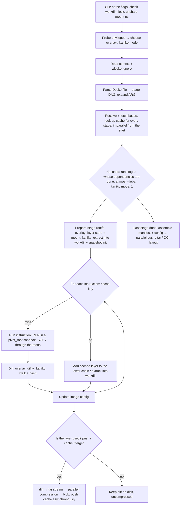

# Proposed Rust architecture

| | |
|---|---|
| **Status** | Frozen, 2026-10-29 |
| **Original** | `docs-rust/03-kien-truc-rust.md` (Vietnamese, not in this repository) |
| **Superseded by** | [`ARCHITECTURE.md`][arch] |

This chapter was a proposal written before any code existed. Crate and module
names were suggestions. There are two snapshot modes, overlay and kaniko
([00][s00] §1, [06][s06], [ADR-0002][adr2]).

## Summary

- **Can it ship as one static binary?** Yes. A static-pie musl build with tokio,
  reqwest (rustls), zstd, flate2 (`zlib-rs`) and sha2 is 5.1 MB, runs in an
  empty rootfs, and cross-builds to `aarch64` **[measured]**. Two things are
  mandatory: `mimalloc`, and a hand-built rustls CA configuration.
- **How is the code split?** A Cargo workspace of 13 crates, from `rk-cli` to
  `rk-builder`, with one `rk-snapshot` crate that holds both the overlay and the
  kaniko implementation behind a `StageRootfs` trait.
- **Which libraries, and what must be written?** `oci-client`, `oci-spec`,
  `tar`, `zstd`, `flate2`, `rustix`/`nix`, `rayon` and `tracing` are usable. The
  Dockerfile parser, the `.dockerignore` matcher, a pigz-style gzip, the
  registry wrapper and the sandbox must be written.
- **How does a build flow?** Probe privileges and pick a mode, parse into a
  stage DAG, fetch bases and look up caches for every stage up front, then
  schedule stages under `--jobs` (1 in kaniko mode). Instructions within a stage
  stay sequential; only layers that are actually used are exported.
- **How big is it?** About 15.5–21 thousand lines excluding tests
  **[inferred]**.

## 1. Packaging as one binary

- Target `x86_64-unknown-linux-musl` → a static binary with no dependency on the
  host's glibc. CI also cross-builds `aarch64-unknown-linux-musl` from the start
  to keep that path open ([05][s05] §4, [ADR-0009][adr9]). The same binary runs
  both on a host and in a `FROM scratch` image, replacing kaniko's `executor` +
  `tini` + `docker-credential-*` bundle
  (`kaniko@44aa7ddc0 deploy/Dockerfile:78-129`).
- Verified ([experiment 05][e05]) **[measured]**: tokio + reqwest (rustls) +
  zstd + flate2 (`zlib-rs`) + sha2 produce a static-pie binary of **5.1 MB**
  (with the `ring` backend) or 7.3 MB (`aws-lc`). The binary runs in an empty
  rootfs. The `aarch64` cross-build uses `cargo-zigbuild` and runs correctly
  under `qemu-aarch64-static` ([ADR-0020][adr20]).
- TLS uses `rustls`, without linking OpenSSL. **reqwest 0.13 dropped the
  `webpki-roots` feature**: by default it reads the system CA store, and in
  `scratch` it fails as soon as the client is created. The
  `rustls::ClientConfig` must be built by hand: the host's CAs if present
  (`/etc/ssl/certs`, `SSL_CERT_FILE`), otherwise the bundled `webpki-roots`. Add
  `--registry-certificate`, as in kaniko.
- **Allocator: `mimalloc` is mandatory.** With 16 threads doing small
  allocations: musl 2.8 Mops/s, musl + mimalloc 700, glibc 900, so musl's
  allocator is about 250–300 times slower **[measured]**. With musl, running on
  many threads is even slower than on one.
- Credential helpers (`docker-credential-ecr-login`, `-gcr` and so on) are
  external binaries. They are called if present on the host, but are not
  required to run.

## 2. Cargo workspace

```
ranikust/
├── Cargo.toml                      workspace
├── crates/
│   ├── rk-cli/          (bin)      clap: build, push, prune, version, login; kaniko-compatible flags
│   ├── rk-dockerfile/              lexer, parser, directives, heredocs, variable expansion, instructions, stage graph, squash
│   ├── rk-ignore/                  .dockerignore with exact moby/patternmatcher semantics
│   ├── rk-context/                 context sources: dir, tar, git, https (open trait; no s3/gcs/azure)
│   ├── rk-oci/                     OCI/Docker types (oci-spec), manifest, config, media types
│   ├── rk-registry/                distribution client: auth, mirrors, blob pull, streaming push, cross-repo mount
│   ├── rk-rootfs/                  RootPath: fd-based access to the workdir (openat2), layer extraction,
│   │                               copy, ownership, xattrs, ignore list, safe filesystem deletion
│   ├── rk-sandbox/                 namespaces, proc/dev/sys mounts, pivot_root, capability dropping, stubs, user lookup in the rootfs, RUN exec, privilege probing
│   ├── rk-snapshot/                StageRootfs trait + two implementations:
│   │                               overlay (mount, diff-k, overlay ⇄ OCI whiteouts, layer store)
│   │                               kaniko (parallel walk + hash, LayeredMap, path resolution, filesystem deletion)
│   ├── rk-sched/                   stage DAG, async scheduling, --jobs, cancel on failure, per-stage logs
│   ├── rk-layer/                   deterministic tar, parallel (de)compression (gzip, zstd), digest, streaming
│   ├── rk-cache/                   cache key, cache layer lookup/push via registry or OCI layout
│   └── rk-builder/                 build a stage, per-instruction executor, lazy layer export, image assembly, output
└── tests/                          golden tests, re-run of kaniko's integration/dockerfiles
```

Mapping from the Go packages:

| kaniko | ranikust |
|---|---|
| `cmd/executor/cmd` | `rk-cli` |
| `pkg/dockerfile` + BuildKit parser | `rk-dockerfile` |
| `pkg/commands` | `rk-builder::commands` |
| `pkg/executor` | `rk-builder` + `rk-sched` (replacing the sequential stage loop in `DoBuild`) |
| `pkg/snapshot`, `pkg/filesystem` | `rk-snapshot` (kaniko mode) |
| — (not in kaniko) | `rk-snapshot` (overlay mode), `rk-sched` |
| `pkg/util/fs_util.go` (extract, copy, ignore list, `DeleteFilesystem`) | `rk-rootfs` |
| `pkg/util/tar_util.go`, `pkg/pgzip`, the tarball part of ggcr | `rk-layer` |
| `pkg/image*`, `pkg/creds`, `pkg/mounts` | `rk-registry`, `rk-oci` |
| `pkg/cache`, `pkg/warmer` | `rk-cache` |
| `pkg/buildcontext` | `rk-context` |
| `pkg/config` (global `RootDir`, `KanikoDir`) | a `BuildPaths { root, state }` struct passed down; no globals |
| `pkg/util/proc`, `swapDir`, `tini`, `kill(-pgid)` | `rk-sandbox` |

## 3. Library choices

Rows marked "verified" were tested in the experiment named in the row
**[measured]**.

| Concern | Choice | Notes |
|---|---|---|
| Async runtime, HTTP | `tokio`, `reqwest` (rustls) or `hyper` | Streaming blob upload needs control over chunking and retries |
| Registry | `oci-client` 0.18 + a wrapper of about 400–600 lines | Verified ([experiment 05][e05]): streams pulls to a file, streams a 500 MB blob push, RSS steady at about 20 MB; supports cross-repository mount. Missing, so wrapped by hand: reading docker `config.json`, retries, mirrors, and falling back to an upload when a mount fails (today it returns an error) |
| OCI types | `oci-spec` 0.10 | Actively maintained |
| Docker config, credential helpers | `docker_credential` 1.4 | Usable, small, few maintainers. Can be vendored if needed |
| Dockerfile parser | **Written in-house**: a port of BuildKit's `parser` + `instructions` + `shell/lex.go`, about 3,000–3,300 lines ([ADR-0015][adr15]) | Verified `parse-dockerfile` 0.1.8 ([experiment 04][e04]). It **fails on heredocs in the middle of an instruction** (`RUN cat <<EOF > /out`, the most common form) and does not expand variables. With 125 lines of glue it matched 198/200 of kaniko's Dockerfiles. Keep the PoC's harness against BuildKit as the compatibility test |
| `.dockerignore` | In-house port of `moby/patternmatcher`, about 350–400 lines | Verified ([experiment 04][e04]): the `ignore` crate disagrees on 19/38 cases; with a pattern-translation layer it still disagrees on 5/38. No crate ports patternmatcher |
| Tar | `tar` | Verified ([experiment 05][e05]): PAX xattrs, hardlinks, long paths and fixed mtimes are all deterministic; GNU tar and `podman load` read the output correctly. **Do not use `append_dir_all`** (no sorting, no hardlink detection, forces modes). Whiteouts are written by hand |
| Gzip | **In-house, pigz-style**, on `flate2` (`zlib-rs`), a few hundred lines | Verified ([experiment 05][e05]): a single member, **deterministic for any thread count**, 2.2 GB/s. `gzp` is deterministic without a dictionary (1.6 GB/s, but t=1 gives different output) and not deterministic with one |
| Zstd | `zstd` (the C library, multithreaded) | [Experiment 05][e05]: 4.2 GB/s on 16 threads. Output **depends on how data is fed to the encoder**: a single 1 GiB `write_all` gave 2 different results at t=32. It is deterministic only when fed in fixed-size blocks (128 KiB) |
| Digest | `sha2` (feature `asm`) or `aws-lc-rs` | sha256 is on the critical path of every layer |
| Snapshot hash | `highway` (HighwayHash, as in kaniko) or `xxhash-rust` (xxh3) | [Experiment 06][e06]: the hash choice barely matters; a parallel walk and a stat-based cache are what count |
| Parallel walk | `jwalk`, or in-house with `rayon` + `getdents64` | The snapshot's critical path |
| Syscalls | `rustix` or `nix` | `openat2`, `mount`, `fsopen`/`fsconfig` (new mount API), `unshare`, `chroot`, `clone3` |
| Sandbox | In-house on `rustix`/`nix`; youki's `libcontainer` **[external]** as a reference | Rationale in [02][s02] §3 |
| CPU parallelism | `rayon` | Hashing, compression |
| Logging, tracing | `tracing`, `tracing-subscriber`, `opentelemetry-otlp` | |

## 4. Build flow



Within a stage, instructions still run sequentially. Parallelism exists only
between stages and in I/O work (fetching, compressing, pushing).

## 5. Estimated code size

All figures are **[inferred]**.

| Crate | Lines (estimate) |
|---|---|
| `rk-dockerfile` | 3,000–3,500 ([experiment 04][e04]) |
| `rk-ignore` | 350–500 ([experiment 04][e04]) |
| `rk-context` | 500 (dir/tar/git) |
| `rk-oci` + `rk-registry` | 1,000–1,500 (`oci-client` wrapper, [experiment 05][e05]) |
| `rk-rootfs` | 1,500–2,000 |
| `rk-sandbox` + privilege probing | 1,500–2,000 ([experiment 02][e02]: the PoC is 840 lines, without `RUN --mount`, stubs or probing) |
| `rk-snapshot` (overlay) | 1,000–1,500 |
| `rk-snapshot` (kaniko) | 1,000–1,500 |
| `rk-sched` | 600–1,000 |
| `rk-layer` | 800–1,200 |
| `rk-cache` | 800–1,200 |
| `rk-builder` (including the instructions) | 3,000–4,000 |
| `rk-cli` | 500 |
| **Total** | **about 15.5–21 thousand lines**, excluding tests |

## References

1. [Experiment 02: RUN sandbox][e02].
2. [Experiment 04: Dockerfile parser][e04].
3. [Experiment 05: Rust ecosystem][e05].
4. [Experiment 06: Overlay vs walk][e06].
5. kaniko at `44aa7ddc0`: `deploy/Dockerfile:78-129`.
6. youki `libcontainer`, <https://crates.io/crates/libcontainer> **[external]**,
   accessed 2026-10-29.
7. Survey chapters: [00 Summary][s00], [02 kaniko-mode requirements][s02],
   [05 Decisions][s05], [06 Overlay and parallelism][s06].

[arch]: ../../../ARCHITECTURE.md
[s00]: 00-summary.md
[s02]: 02-kaniko-mode-requirements.md
[s05]: 05-decisions.md
[s06]: 06-overlay-and-parallelism.md
[e02]: ../experiments/02-run-sandbox.md
[e04]: ../experiments/04-dockerfile-parser.md
[e05]: ../experiments/05-rust-ecosystem.md
[e06]: ../experiments/06-overlay-vs-walk.md
[adr2]: ../../adr/0002-two-snapshot-modes.md
[adr9]: ../../adr/0009-x86-64-first-aarch64-ready.md
[adr15]: ../../adr/0015-hand-written-dockerfile-parser.md
[adr20]: ../../adr/0020-static-musl-via-cargo-zigbuild.md
